<div align="center">

# WAS-SSL

### Leakage-Aware Weighted-Anchor Stacking of Self-Supervised Models for Multiclass Skin Lesion Classification

**Researcher:** Anirban Roy  
**Research supervisor:** Sk. Md. Masudul Ahsan  
**Department of Computer Science and Engineering**  
**Khulna University of Engineering & Technology (KUET), Bangladesh**

*Research code and figures · Manuscript in preparation · Not a clinical diagnostic tool*


[Overview](#research-overview) · [Proposed method](#the-proposed-was-ssl-ensemble) · [Results](#results) · [Figures](#research-figures) · [Notebooks](#research-notebooks) · [Reproducibility](#reproducibility)

</div>

## Research overview

This repository documents an eight-class dermoscopic lesion-classification study using **supervised ResNet50**, self-supervised **Rotation** and **SimCLR**, additional **DINOv2** experiments in the original track, learned **feature-fusion heads**, and probability-level **stacking ensembles**. It compares a historical **image-level** evaluation with a revised **lesion-aware** protocol and analyzes source-attributed HAM10000/BCN20000 subsets, calibration, per-class recall, uncertainty and visual explanations.

The proposed research candidate, **WAS-SSL**, blends a calibrated optimized-weighting ensemble and a fitted logistic stacker at a fixed **60:40** ratio. It is evaluated using **frozen trained predictors**, without test-time retraining of base networks. WAS-SSL is currently a **provisional model**: its observed performance is encouraging but not a claim of statistically established superiority or independent clinical validation.

| Research components | Evidence included |
|:--|:--|
| **Classification task** | Eight ISIC 2019 diagnostic classes (MEL, NV, BCC, AK, BKL, DF, VASC, SCC) |
| **Experimental protocols** | Image-aware thesis track and corrected lesion-aware N01 track |
| **Model families** | ResNet50, Rotation SSL, SimCLR, DINOv2 (original track), four fusion heads |
| **Ensemble analysis** | Weighted averaging, logistic stacking, anchored blending, optional class bias |
| **Evaluations** | ISIC 2019, HAM/BCN-attributed source subsets, ablations, calibration, XAI |
| **Research archive** | **35 executed notebooks**, results tables, verification metadata, **12 supplied PDF figures** + GitHub PNG renderings |

## Results

### Main numbers

| Evaluation | WAS-SSL balanced accuracy | Comparator / context |
|:--|--:|:--|
| **ISIC 2019 · original J1 test** (2,534 images) | **83.29%** | Original SimCLR-anchored, no bias: 84.00%; historical class-bias CalStack: 83.95% |
| **ISIC 2019 · lesion-aware N01 validation** (2,186 images) | **61.69%** | N01 R07 class-bias stacking: 62.04% |
| **HAM-attributed · image-aware** (999 images) | **81.98%** | Optimized weighting: 77.54% |
| **BCN-attributed · image-aware** (1,240 images) | **83.18%** | Optimized weighting: 81.38% |
| **HAM-attributed · lesion-aware** (1,060 images) | **66.55%** | Optimized weighting: 65.69% |
| **BCN-attributed · lesion-aware** (1,049 images) | **49.06%** | R07 historical class-bias blend: 49.72% |

**Interpretation:** No single ensemble wins every cohort. The four-cohort mean for WAS-SSL is **70.19% BACC**, versus **70.00%** for the historical track-specific class-bias CalStack. The 0.19 percentage-point difference is **exploratory, not statistically established superiority**. The full N01 locked test remains unevaluated here.

### Source-stratified performance

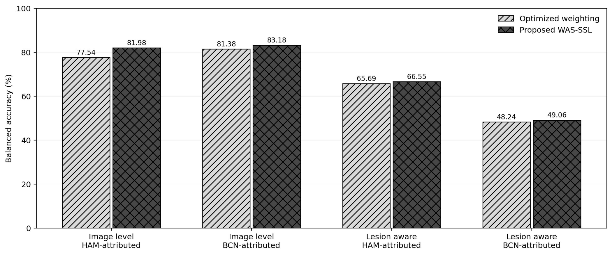

[View high-resolution PDF](assets/figures/source-pdfs/source_stratified_bacc.pdf) · [Complete G05 cohort table](results/g05_ham_bcn_source_bacc.csv) · [G05 notebook](notebooks/04_cross_protocol/08_g05_frozen_was_ssl.ipynb)

### Ensemble comparisons on full ISIC 2019

| Ensemble | Original image-aware J1 **test** BACC | N01 lesion-aware **validation** BACC |
|:--|--:|--:|
| Logistic stacking | 82.99% | 58.11% |
| Optimized weighting | 81.03% | 60.69% |
| Original SimCLR-anchor stacking, no bias | **84.00%** | 59.21% |
| Historical/R07 class-bias CalStack | 83.95% | **62.04%** |
| **Proposed WAS-SSL · weighted-anchor, no bias** | **83.29%** | **61.69%** |
| Weighted-anchor stacking with original class bias | 83.43% | 59.95% |

These two columns are **different datasets/splits** (J1 test versus N01 validation). They do not isolate the causal effect of removing lesion-level leakage. [Machine-readable table](results/g05_full_isic_bacc.csv).

### Common-family comparison on HAM/BCN subsets

| Ensemble family | Image HAM | Image BCN | Lesion HAM | Lesion BCN | Mean BACC |
|:--|--:|--:|--:|--:|--:|
| **WAS-SSL: weighted anchor + stack, no bias** | **81.98** | **83.18** | **66.55** | 49.06 | **70.19** |
| Historical class-bias CalStack | 81.44 | 82.50 | 66.34 | **49.72** | 70.00 |
| Weighted anchor + stack + class bias | 81.14 | 83.18 | 65.24 | 46.93 | 69.12 |
| SimCLR anchor + stack, no bias | 81.74 | 82.68 | 65.86 | 45.71 | 69.00 |
| Optimized weighting | 77.54 | 81.38 | 65.69 | 48.24 | 68.21 |
| Logistic stacking | 82.89 | 81.77 | 61.72 | 45.51 | 67.97 |

*Values are BACC percentages. An unweighted mean of four BACC values is not an independently measured dataset-level accuracy. These are not unseen-domain transfer tests.*

### Per-class recall and error patterns

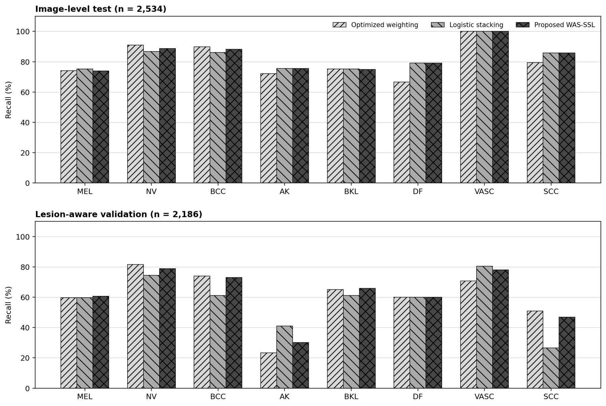

[View high-resolution PDF](assets/figures/source-pdfs/per_class_recall.pdf) · [Source figure notes](docs/FIGURE_GALLERY.md)

#### WAS-SSL confusion matrices

<table>
<tr><th>Original image-aware test (n = 2,534)</th><th>Lesion-aware validation (n = 2,186)</th></tr>
<tr>
<td>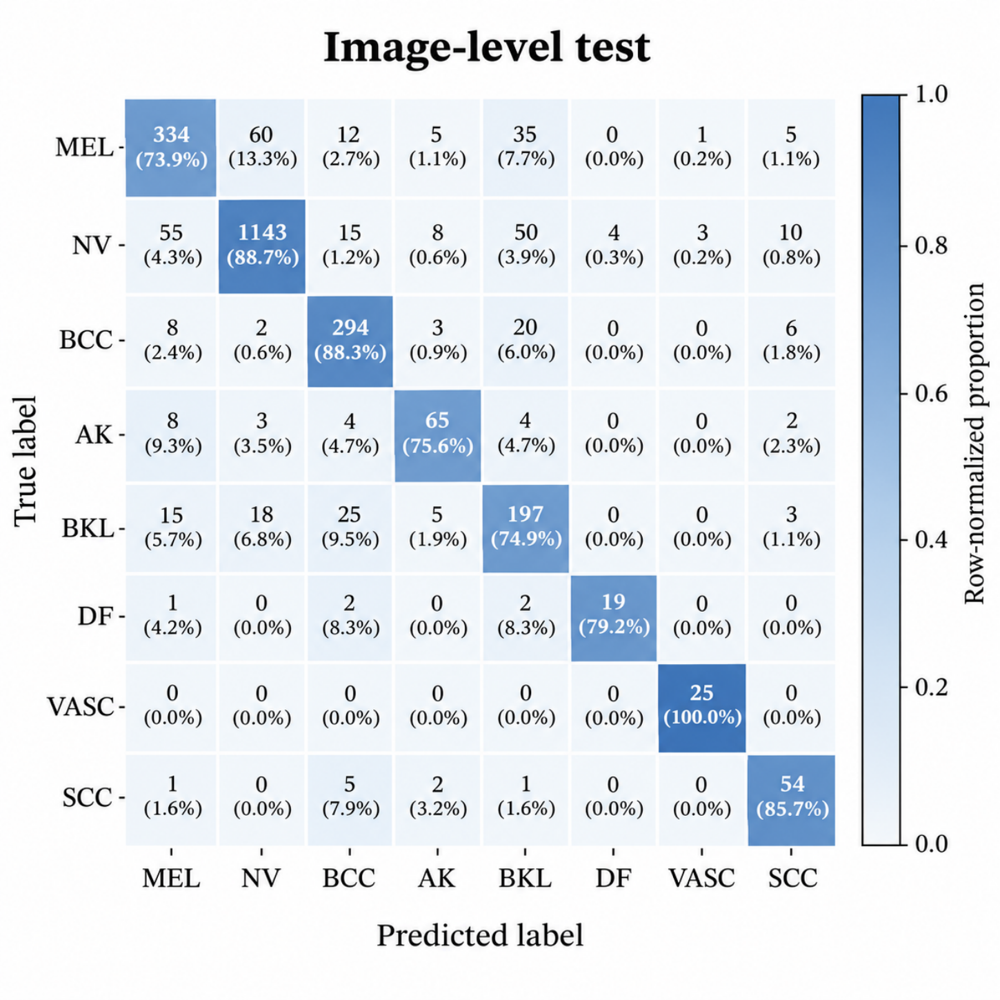</td>
<td>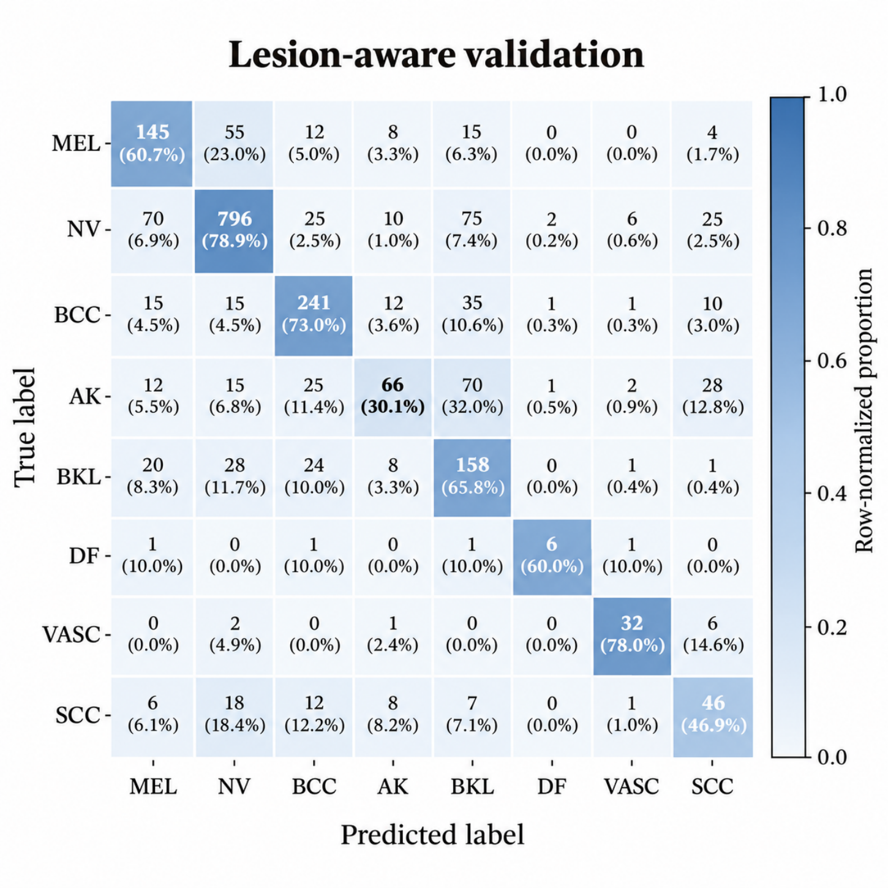</td>
</tr>
</table>

The confusion-matrix diagonals independently reproduce approximately **83.29%** image-aware test BACC and **61.69%** lesion-aware validation BACC. [Image-aware matrix PDF](assets/figures/source-pdfs/confusion_image_aware_was.pdf) · [Lesion-aware matrix PDF](assets/figures/source-pdfs/confusion_lesion_aware_was.pdf).

### Representative base models on source subsets

| Base model | Image HAM | Image BCN | Lesion HAM | Lesion BCN |
|:--|--:|--:|--:|--:|
| Supervised ResNet50 | 77.51 | 80.86 | 68.43 | 46.51 |
| Rotation SSL | 75.14 | 72.05 | 61.62 | 47.02 |
| SimCLR (no TTA) | 76.36 | 81.54 | 67.67 | 44.40 |
| FusionConcat | 77.96 | 77.00 | 64.89 | 46.78 |
| FusionGatedV2 | 75.73 | 78.15 | 68.64 | 44.49 |
| FusionGatedV3 | 73.72 | 75.59 | 66.62 | 45.95 |
| ResidualFusion | 77.71 | 78.34 | 67.70 | 47.66 |

All values are BACC (%). [Complete table, including image-aware SimCLR TTA](results/base_model_ham_bcn_bacc.csv) · [J10 detailed metrics including CIs, AUROC, PR-AUC, MCC and ECE](results/j10_recorded_full_metric_table.txt).

## The proposed WAS-SSL ensemble

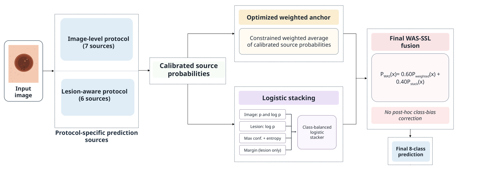

[View high-resolution PDF](assets/figures/source-pdfs/was_ssl_framework.pdf) · [Original thesis probability-source diagram](assets/figures/research/image_aware_prediction_pipeline.png)

For each sample \(x\), the frozen proposed ensemble combines two fitted probability predictors:

```python
P_WAS=0.60*P_weighted+0.40*P_stack
predicted_class=P_WAS.argmax(axis=1)
```

- **Weighted branch:** development-fitted constrained weighting of calibrated base-model probabilities.
- **Stacking branch:** a fitted class-balanced logistic stacker over model-derived features.
- **Final fusion:** 60% optimized weighting and 40% stacking; **no post-hoc class-bias correction**.
- **Protocol distinction:** the original experiment uses **seven** prediction sources while the lesion-aware experiment uses **six**; fitted parameters differ. The family and blending rule are shared, not a single shared set of pretrained weights.

Hyperparameters selected after examining evaluation results should be considered exploratory. [Selection caveats](docs/RESULTS_INTERPRETATION.md) · [Training and evaluation protocol](docs/DATA_AND_LEAKAGE.md).

## Research figures

### Original image-level source construction

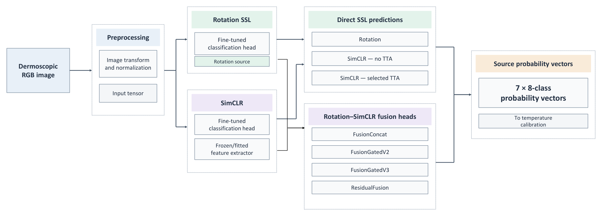

[Full figure](assets/figures/source-pdfs/image_aware_prediction_pipeline.pdf) · [Original uncropped PDF](assets/figures/source-pdfs/image_aware_prediction_pipeline_full.pdf)

### Revised lesion-aware model construction

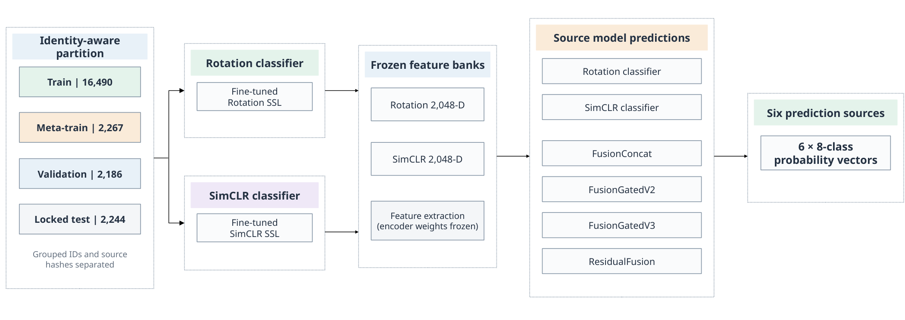

[View high-resolution PDF](assets/figures/source-pdfs/lesion_aware_prediction_pipeline.pdf)

### Four learned feature-fusion heads

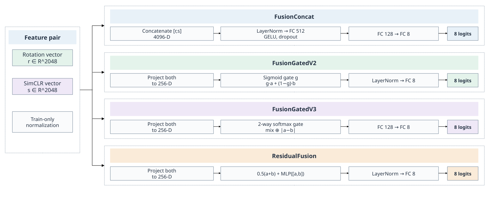

[View high-resolution PDF](assets/figures/source-pdfs/feature_fusion_architectures.pdf)

### Explainable AI: Grad-CAM, Grad-CAM++ and Score-CAM

**Image-aware experiment (J14)**

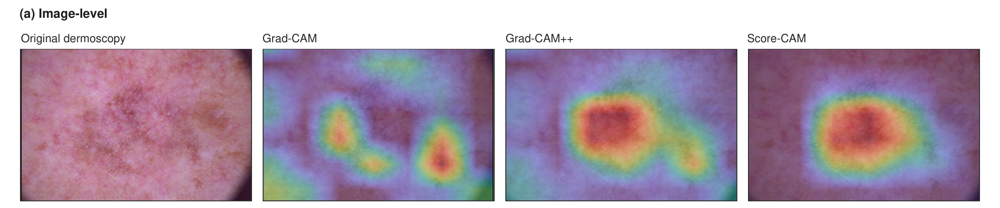

[View high-resolution PDF](assets/figures/source-pdfs/xai_image_aware.pdf)

**Lesion-aware experiment (J13)**

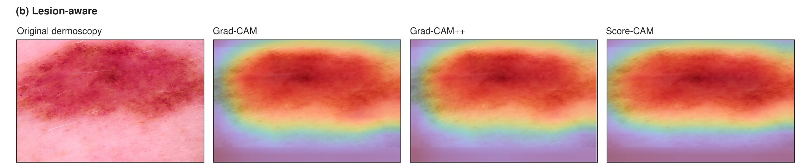

[View high-resolution PDF](assets/figures/source-pdfs/xai_lesion_aware.pdf)

**XAI limitation:** The overlays are **qualitative illustrations**, not quantitative evidence that highlighted pixels correspond to clinical lesion boundaries. The supplied XAI figures reproduce dermoscopic images; **review the originating image dataset's license/redistribution terms before making the repository public**. [XAI notebook descriptions](results/XAI_STATUS.md).

<details>
<summary><b>Supplementary figure: additional confusion-matrix comparison (separate provenance)</b></summary>

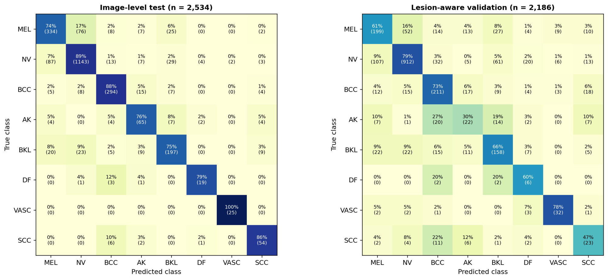

[View high-resolution PDF](assets/figures/source-pdfs/additional_confusion_comparison.pdf). This uploaded figure's cell counts do **not** match the primary WAS-SSL matrices shown above; its exact fitted model/protocol association was not confirmed. It is intentionally **not** cited as the proposed model's confusion matrix.

</details>

[Browse all figure files, sources and captions](docs/FIGURE_GALLERY.md) · [PDF/PNG provenance manifest](metadata/figure_manifest.csv)

## Datasets and evaluation design

| Item | Original image-level protocol | Corrected lesion-aware N01 protocol |
|:--|:--|:--|
| Dataset | ISIC 2019 | ISIC 2019 |
| Main evaluation above | J1 **test**, n = 2,534 | N01 **validation**, n = 2,186 |
| Training images | 20,264 | 16,490 |
| Meta-train | — | 2,267 |
| Original validation | 2,533 | N01 validation: 2,186 |
| Locked test | J1 test already evaluated | **2,244; not evaluated in this release** |
| Quarantine | — | 2,144 |
| HAM source-attributed subset | 999 | 1,060 |
| BCN source-attributed subset | 1,240 | 1,049 |

The subsets called **HAM10000** and **BCN20000** in these results are *source-attributed ISIC 2019 images*, not two untouched external datasets. The original J1 split is image-level, and images of a lesion may have appeared in multiple partitions. The N01 grouped split was constructed to address that concern, but observed cross-protocol differences also reflect changed training/evaluation cohorts. [Audit details](docs/DATA_AND_LEAKAGE.md).

## Research notebooks

The repository preserves **35 executed notebooks** grouped by research stage; raw dataset files and trained model binaries remain external Kaggle dependencies.

| Stage | Contents | Where to start |
|:--|:--|:--|
| **1. Original thesis** | Supervised learning, Rotation / SimCLR, fusion, historical ensemble | [Original thesis ensemble](notebooks/01_original_thesis/02_original_trained_ensemble.ipynb) |
| **2. Journal extensions J1–J9** | DINOv2, progressive ablation, significance tests, calibration, XAI | [Ablation notebook J3](notebooks/02_journal_extension/03_j3_progressive_ablation.ipynb) |
| **3. Lesion-aware N01/R01–R07** | Identity-aware audit, supervised and SSL retraining, frozen features, ensembles | [N01 split audit](notebooks/03_lesion_aware/00_n01_split_audit.ipynb) |
| **4. Cross-protocol G01–G05** | Provenance matching, HAM/BCN subsets, comparable ensemble families, WAS-SSL | [G05 frozen WAS-SSL](notebooks/04_cross_protocol/08_g05_frozen_was_ssl.ipynb) |
| **5. Reporting J10–J14** | Consolidated metrics, supervised benchmarks, Grad-CAM families | [J10 metrics](notebooks/05_reporting_and_xai/10_j10_all_journal_metrics.ipynb) |

**Navigation:** [Full notebook catalog](docs/NOTEBOOK_CATALOG.md) · [Recommended execution order](docs/EXECUTION_ORDER.md) · [Kaggle input mapping](docs/KAGGLE_INPUTS.md) · [Notebook source SHA256 and output-removal manifest](metadata/notebook_manifest.csv).

### Supporting analyses

- **Ablations:** [J3 twelve-stage progression](results/j3_original_ablation_bacc.csv), including Rotation, SimCLR, fusion heads, weighted ensembles and stacking.
- **Statistical analysis:** [J4/J8/J9 notebooks](docs/NOTEBOOK_CATALOG.md), including recorded paired comparisons; no unsupported claim of WAS-SSL statistical superiority.
- **Calibration and reliability:** [J6 and J10](docs/NOTEBOOK_CATALOG.md), including temperature scaling, multiclass Brier and expected calibration error.
- **Explainability:** [J13](notebooks/05_reporting_and_xai/13_j13_lesion_aware_xai.ipynb) and [J14](notebooks/05_reporting_and_xai/14_j14_original_xai.ipynb); example XAI panels are shown above.

## Reproducibility

1. Explore the [notebook catalog](docs/NOTEBOOK_CATALOG.md) and [execution order](docs/EXECUTION_ORDER.md).
2. Attach the **exact prior Kaggle outputs** (including frozen checkpoints, prediction arrays and split manifests) listed in [Kaggle inputs](docs/KAGGLE_INPUTS.md).
3. Use the notebook's Kaggle GPU/CPU setting, with individual stages designed to run in bounded sessions. Dependencies are summarized in [`requirements.txt`](requirements.txt).
4. Verify notebook source integrity and table files with `python scripts/verify_repository.py`.
5. Reconcile the [known issues](docs/KNOWN_ISSUES.md) and [reporting limitations](docs/RESULTS_INTERPRETATION.md) before interpreting any headline result.

> **Not standalone:** This repository does not include raw ISIC images, pretrained weights, historical Kaggle checkpoints or all prediction artifacts. It includes notebooks with original code and numerical/text outputs plus the user-supplied research figures. Embedded notebook images/HTML were removed for publication, and the alterations are recorded in the notebook manifest.

## Scientific limitations and publication status

- **N01 locked test remains unreported** in this research archive. Before claiming final model performance, freeze a development-selected ensemble and evaluate this test **once**.
- **Model-family selection from exploratory test comparisons is not independent validation.** WAS-SSL (70.19% mean BACC) does not demonstrate statistically proven superiority over historical CalStack (70.00%).
- **Cross-protocol scores are not directly paired** because samples and training histories differ.
- **HAM and BCN source-attributed subsets are not unseen external cohorts.** No independent HAM-to-BCN transfer claim is established.
- **XAI is qualitative**, not an independently validated clinical localization score.
- **Clinical use is not supported:** research analysis only; not for medical advice or diagnosis.

## Research team and citation

| Role | Name | Affiliation |
|:--|:--|:--|
| Researcher / first author | **Anirban Roy** | Department of Computer Science and Engineering, KUET |
| Supervisor / co-author | **Sk. Md. Masudul Ahsan** | Department of Computer Science and Engineering, KUET |

The manuscript is **in preparation**. Cite this repository using the author and institutional details once finalized; no publication DOI is claimed. [`CITATION.cff.template`](CITATION.cff.template) is included for later completion. [References](references/references.txt).

**Licensing and ethics:** No code license has been assigned. Review [license guidance](LICENSE_RECOMMENDATION.md), the [public-release checklist](docs/PUBLIC_RELEASE_CHECKLIST.md), and figure/dataset redistribution permissions before publishing. The included XAI panels contain skin-lesion photographs supplied as part of the research figures; they should not be mistaken for newly licensed stock imagery.

---

<div align="center"><sub>WAS-SSL · KUET · 8-class dermoscopy · Source-supported results · Research software</sub></div>
